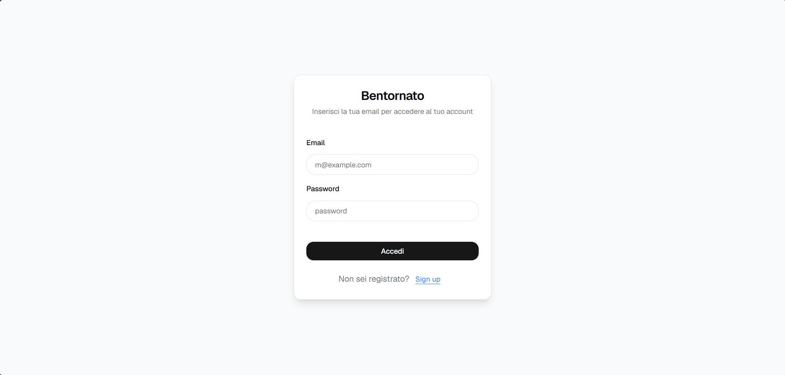
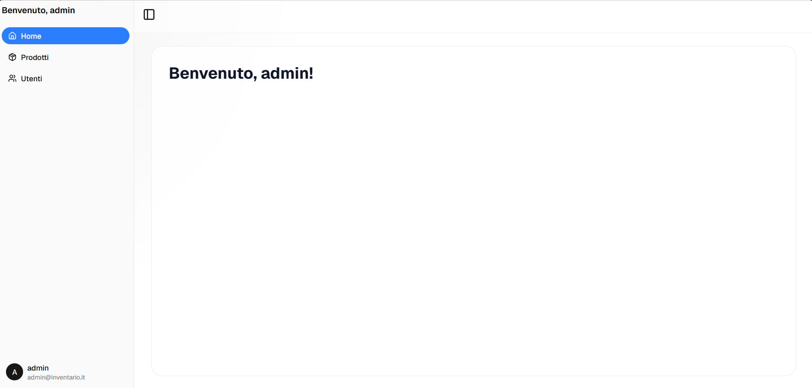
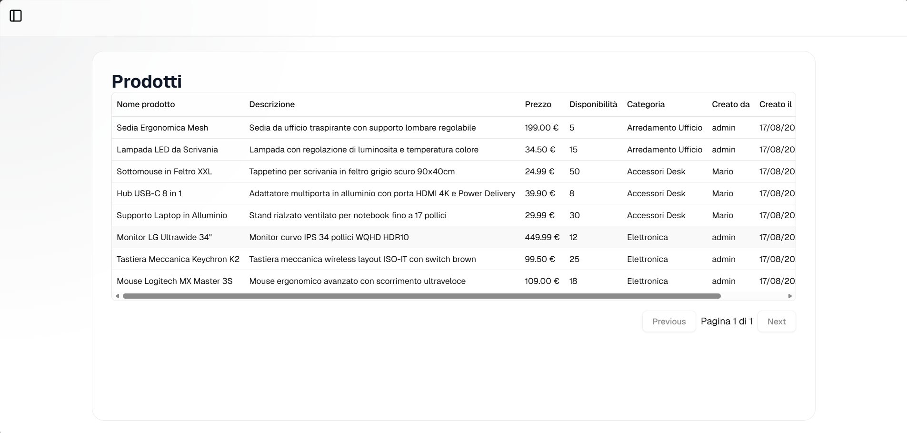

# Inventory Management System

Applicazione full-stack per la gestione di prodotti, utenti e autorizzazioni con autenticazione JWT, API REST Node.js/Express, database MySQL e frontend React.

## Live Demo

Frontend:
https://inventory-management-app-seven-peach.vercel.app

Backend API:
https://inventory-management-api-xxxx.onrender.com

## Screenshots

## Login



## Dashboard



## Products



## Features

- Autenticazione JWT
- Gestione utenti con ruoli Admin/User
- Registrazione e login utenti
- CRUD prodotti
- Ricerca prodotti
- Filtro per categoria
- Paginazione lato backend
- CRUD utenti riservato agli admin
- autorizzazione admin
- validazione dati con Zod
- controllo token e sessione utente
- script SQL per schema e dati demo
- Verifica connessione database all'avvio
- Database MySQL relazionale
- API REST Documentate e testate con Postman
- Deploy frontend su Vercel
- Deploy backen su Render
- Database cloud Aiven

## Architecture

- Frontend: React + Vite
- API: Node.js + Express
- Database: MySQL
- Authentication: JWT
- State Management: Zustand
- Frontend Hosting: Vercel
- Backend Hosting: Render
- Database Hosting: Aiven

## Deploy

L'applicazione è distribuita su infrastruttura cloud:

- Frontend deployato su Vercel
- Backend deployato su Render
- Database MySQL ospitato su Aiven

Le variabili d'ambiente sono gestite tramite i pannelli di configurazione delle rispettive piattaforme e non sono presenti nella repository.

### 🚧 Frontend in sviluppo attivo

Completato:

- Login utente
- Registrazione utente
- Gestione stato autenticazione con Zustand
- Form validation con React Hook Form e Zod
- Client Axios configurato
- Componenti UI con shadcn/ui
- React Router configurato

In sviluppo:

- Dashboard
- Gestione prodotti
- Gestione utenti
- Integrazione React Query

## Tecnologie utilizzate

### Backend

- Node.js
- Express
- MySQL
- mysql2
- bcryptjs
- jsonwebtoken
- dotenv
- cors
- zod

### Frontend

- React e Vite
- React Router
- Tailwind CSS
- shadcn/ui e Radix UI
- React Hook Form e Zod
- Axios
- Zustand

---
## Struttura del progetto

```text
inventory-management-app/
├── backend/
│   ├── db/
│   ├── postman/
│   ├── src/
│   │   ├── config/
│   │   ├── controllers/
│   │   ├── middlewares/
│   │   ├── routes/
│   │   ├── services/
│   │   └── index.js
│   └── package.json
│
├── frontend/
│   ├── src/
│   │   ├── components/
│   │   ├── pages/
│   │   ├── routes/
│   │   ├── store/
│   │   └── lib/
│   └── package.json
│
└── README.md
```

> Il file `.env` non va committato nella repository.

---

### ✅ Verifiche eseguite

- avvio del server sulla porta `5000`
- connessione al database MySQL
- autenticazione e recupero dati utente loggato
- registrazione e login con password hashata
- accesso ai prodotti e categorie
- CRUD prodotti
- CRUD utenti con ruoli admin/user
- protezione di rotte admin
- completamento test delle API principali

## Setup ambiente

### 1) Installazione dipendenze

```bash
cd backend
npm install
```

### 2) Configurazione variabili d'ambiente

Crea un file `.env` dentro `backend/`:

```env
DB_HOST=localhost
DB_USER=root
DB_PASSWORD=la_tua_password
DB_NAME=nome_db
DB_PORT=3306
PORT=5000
JWT_SECRET=una_chiave_segretissima_e_casuale
```

### 3) Avvio del server

```bash
cd backend
npm start
```

Per sviluppo con riavvio automatico:

```bash
cd backend
npm run dev
```

Il backend sarà disponibile all'indirizzo:

```text
http://localhost:5000
```

### 4) Avvio del frontend

In un secondo terminale, dalla cartella `frontend/`, installa le dipendenze e avvia Vite:

```bash
cd frontend
npm install
npm run dev
```

Vite mostrerà nel terminale l'indirizzo locale del frontend. Il client HTTP è attualmente configurato per raggiungere il backend su `http://localhost:5000/api`; assicurati quindi che il server e il database siano attivi.

Il frontend è ancora in sviluppo: alcune route in `App.jsx` fanno riferimento a pagine non ancora implementate, quindi l'applicazione non è ancora completa.

---

## Database e dati demo

Crea il database e applica gli script SQL nell'ordine corretto:

```bash
mysql -u root -p inventario_db < db/schema.sql
mysql -u root -p inventario_db < db/seed.sql
```

### Credenziali demo

Password di tutti gli utenti demo:

password123

Account presenti nel seed:

- `admin@inventario.it` → ruolo `admin`
- `mario.rossi@inventario.it` → ruolo `user`

---
## 🧪 Testing con Postman

Nella repository è inclusa una collection Postman pronta all'uso per testare tutte le rotte API.

### Come importare ed usare la collection:
1. Apri **Postman** e clicca su **Import**.
2. Seleziona il file `backend/postman/gestionale-inventory.postman_collection.json`.
3. Assicurati che il server backend sia avviato su `http://localhost:5000`.
4. **Autenticazione:**
   - Esegui la chiamata `POST /api/auth/login` con le credenziali demo admin.
   - Copia il token JWT presente nel body della risposta.
   - Clicca sulla radice della Collection in Postman, apri la scheda **Variables** e incolla il token nel campo `authToken`.
5. **Path Variables:** Per le chiamate che richiedono un ID (es. `GET /api/products/:id`), inserisci l'ID desiderato nella scheda **Params** -> **Path Variables**.

---

```md 
## API Features

### Authentication
- User registration
- User login
- JWT authentication
- Current user session

### Products
- Create product
- Read product
- Update product
- Delete product
- Search
- Category filtering
- Pagination

 ### Users
- User management (Admin only)
- Role-based authorization Per i dettagli delle richieste e delle risposte API è disponibile la collection Postman nella cartella `backend/postman/`.

## Esempi di payload

### Registro utente

```json
{
  "username": "nuovo_utente",
  "email": "nuovo@inventario.it",
  "password": "password123"
}
```

### Login

```json
{
  "email": "admin@inventario.it",
  "password": "password123"
}
```

### Creazione prodotto

```json
{
  "title": "Nuovo prodotto",
  "description": "Descrizione del prodotto",
  "price": 25.9,
  "stock_quantity": 10,
  "category_id": 1
}
```

### Aggiornamento prodotto con PATCH

```json
{
  "price": 29.99,
  "stock_quantity": 15
}
```

### Aggiornamento utente con PATCH

```json
{
  "role": "admin",
  "email": "nuovo@email.it"
}
```

## Validazione e sicurezza

- le password vengono salvate in modo sicuro con `bcryptjs`
- il token JWT viene generato con `jsonwebtoken`
- il middleware `verifyToken` controlla la presenza e la validità del token
- il middleware `isAdmin` limita le operazioni sensibili agli admin
- i dati in input vengono validati con `zod`
- gli endpoint prendono parametri SQL in modo sicuro tramite prepared statements

## Note finali

Questo progetto mi ha permesso di approfondire:

- Sviluppo API REST con Express
- Autenticazione JWT
- Autorizzazione basata sui ruoli
- Modellazione database MySQL
- Query SQL parametrizzate
- Deploy cloud di applicazioni full-stack
- Gestione variabili d'ambiente
- Architettura frontend React moderna
- Gestione dello stato globale con Zustand

