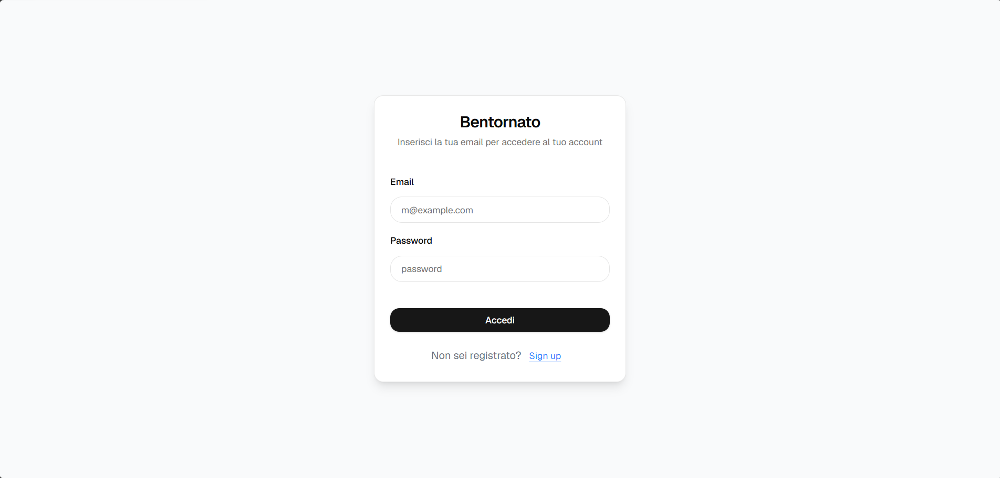
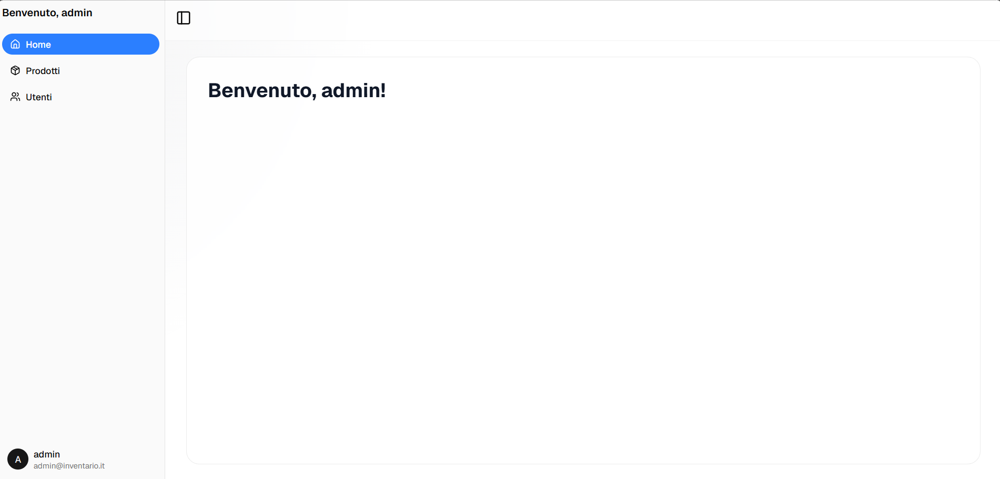
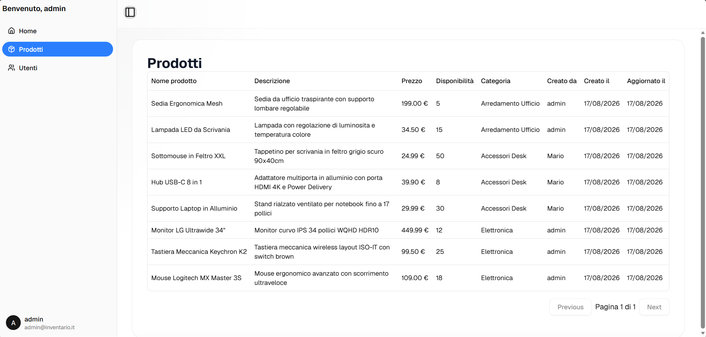

# Inventory Management System

Full-stack Inventory Management System sviluppato con React, Node.js, Express e PostgreSQL.

L'applicazione consente la gestione di utenti, prodotti e autorizzazioni tramite API REST protette con JWT e include una dashboard amministrativa per la gestione dell'inventario.

Originariamente il progetto utilizzava MySQL come database principale. In seguito alla modifica dei piani gratuiti di Aiven, il database è stato migrato completamente a PostgreSQL, includendo la conversione dello schema, delle query backend e dell'infrastruttura cloud.

## Live Demo

Frontend:
https://inventory-management-app-seven-peach.vercel.app

> Nota: la demo utilizza servizi cloud gratuiti (Vercel, Render e Aiven) e potrebbe richiedere alcuni secondi per il riavvio automatico delle istanze inattive.

# 🛠 Tech Stack

## Frontend

- React
- Vite
- React Router
- Zustand
- Axios
- Tailwind CSS
- shadcn/ui
- React Hook Form
- Zod

## Backend

- Node.js
- Express
- PostgreSQL
- pg
- JWT
- bcryptjs
- CORS
- dotenv

## Cloud & Deploy

- Vercel
- Render
- Aiven PostgreSQL

## ✨ Features

# Authentication

- Registrazione utenti
- Login utenti
- JWT Authentication
- Gestione sessione utente
- Middleware di autorizzazione

# Product Management

- CRUD prodotti
- Ricerca prodotti
- Filtro categorie
- Paginazione backend

# User Management

- Gestione utenti
- Ruoli Admin/User
- Operazioni amministrative protette

# Database

- Database relazionale PostgreSQL
- Trigger PostgreSQL per aggiornamento automatico di updated_at
- Foreign Key progettate in base alle regole di business
- Seed database per ambiente demo

# Testing & Quality

- API documentate tramite Postman
- Query SQL parametrizzate
- Validazione dati con Zod
- Password crittografate con bcrypt
- Testing end-to-end completato

---

## 🔄 PostgreSQL Migration

Una delle parti più interessanti del progetto è stata la migrazione completa da MySQL a PostgreSQL.

La migrazione è stata resa necessaria dalla dismissione del piano gratuito MySQL da parte di Aiven.

- Attività svolte
- Conversione schema MySQL → PostgreSQL
- Conversione seed iniziale
- Migrazione backend da mysql2 a pg
- Conversione placeholder SQL
- Introduzione Trigger PostgreSQL
- Revisione delle Foreign Key
- Aggiornamento deploy cloud

# Conversioni principali

MySQL	                              PostgreSQL
AUTO_INCREMENT	                    SERIAL
ENUM	                              CHECK Constraint
mysql2	                            pg
?	                                  $1, $2, $3
ON UPDATE CURRENT_TIMESTAMP	        Trigger PostgreSQL

# Decisioni progettuali
Users → Products
ON DELETE RESTRICT
Motivazione:
I prodotti devono mantenere il riferimento al proprio creatore per garantire la tracciabilità storica.
Categories → Products
ON DELETE SET NULL
Motivazione:

L'eliminazione di una categoria non deve comportare la perdita dei prodotti associati.

# Aggiornamento automatico di updated_at
Implementato tramite:

- Trigger PostgreSQL
- Trigger Function dedicata

---

## 📸 Screenshots

## Login



## Dashboard



## Products



# ☁️ Deploy

L'applicazione è completamente deployata in cloud:

Frontend su Vercel
Backend su Render
Database PostgreSQL su Aiven

Le variabili d'ambiente sono gestite tramite i pannelli di configurazione delle rispettive piattaforme e non sono presenti nella repository.

## ✅ Test eseguiti

# Backend
- Connessione PostgreSQL
- Registrazione utenti
- Login utenti
- CRUD prodotti
- CRUD utenti
- Middleware JWT
- Middleware Admin
# Database
- Trigger updated_at
- ON DELETE SET NULL
- ON DELETE RESTRICT
- Seed PostgreSQL
# End-to-End
Frontend Vercel
        ↓
Backend Render
        ↓
PostgreSQL Aiven
---
## 📁 Struttura del Progetto

```text
inventory-management-app/
├── backend/
│   ├── db/
│   ├── postman/
│   ├── src/
│   │   ├── config/
│   │   ├── controllers/
│   │   ├── middlewares/
│   │   ├── routes/
│   │   ├── services/
│   │   └── index.js
│   └── package.json
│
├── frontend/
│   ├── src/
│   │   ├── components/
│   │   ├── pages/
│   │   ├── routes/
│   │   ├── store/
│   │   └── lib/
│   └── package.json
│
└── README.md
```
# ⚙️ Setup Locale

1. Backend
cd backend
npm install

# Variabili d'ambiente

```env
DB_HOST=localhost
DB_USER=root
DB_PASSWORD=la_tua_password
DB_NAME=nome_db
DB_PORT=15384
PORT=5000
JWT_SECRET=una_chiave_segretissima_e_casuale
```
# Avvio
npm run dev

2. Frontend
cd frontend
npm install
npm run dev

# 🗄 Database e Dati Demo

La repository include:

- script schema database
- seed dati demo
- collection Postman

Credenziali Demo
password123
Account presenti nel seed :
- `admin@inventario.it` → ruolo `admin`
- `mario.rossi@inventario.it` → ruolo `user`

## 🧪 Testing con Postman

Nella repository è presente una collection Postman completa all'interno della cartella:

### Come importare ed usare la collection:
1. Apri **Postman** e clicca su **Import**.
2. Seleziona il file `backend/postman/gestionale-inventory.postman_collection.json`.
3. Assicurati che il server backend sia avviato su `http://localhost:5000`.
4. **Autenticazione:**
   - Esegui la chiamata `POST /api/auth/login` con le credenziali demo admin.
   - Copia il token JWT presente nel body della risposta.
   - Clicca sulla radice della Collection in Postman, apri la scheda **Variables** e incolla il token nel campo `authToken`.
5. **Path Variables:** Per le chiamate che richiedono un ID (es. `GET /api/products/:id`), inserisci l'ID desiderato nella scheda **Params** -> **Path Variables**.

## 🔒 Validazione e Sicurezza

- le password vengono salvate in modo sicuro con `bcryptjs`
- il token JWT viene generato con `jsonwebtoken`
- il middleware `verifyToken` controlla la presenza e la validità del token
- il middleware `isAdmin` limita le operazioni sensibili agli admin
- i dati in input vengono validati con `zod`
- gli endpoint prendono parametri SQL in modo sicuro tramite prepared statements

## 📚 What I Learned
Questo progetto mi ha permesso di approfondire:

- REST API con Express
- Autenticazione JWT
- Autorizzazione basata sui ruoli
- PostgreSQL
- Trigger e Foreign Key
- Migrazione MySQL → PostgreSQL
- Database design e regole di business
- Deploy cloud con Vercel, Render e Aiven
- Gestione SSL per connessioni database cloud
- Architettura React moderna con Zustand

